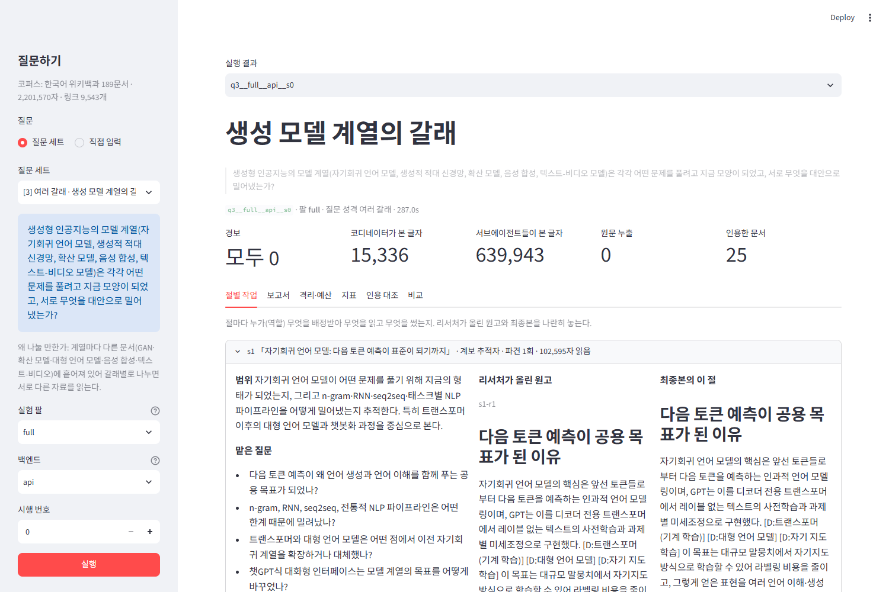

# my-deep-researcher

컨텍스트 윈도우 하나에 다 들어가지 않는 자료를 **코디네이터**가 내용 단위로 나눠 맡기고, **리서처 서브에이전트**들은
자기가 읽은 자료만 컨텍스트에 둔 채 자기 몫의 절을 씁니다. 원고들을 이어 붙여 장문 보고서를 만듭니다.
오케스트레이션은 LangGraph, 모델 호출은 OpenAI API(`gpt-5.4-mini`)로 했습니다. 모델과 공급자는 `config.json`의 `provider`·`model`로 바꿀 수 있습니다(`openai` 또는 `anthropic`).

설계 설명, 지표, 구조도, 데모 설계, 회고는 [REPORT.md](REPORT.md)에 있습니다.

```
my-deep-researcher/
├── data/            # corpus.json (docs + links) · questions.json (질문과 "왜 나눌 만한가")
├── config.json      # 도메인에 묶인 값 (절 수 · 절 예산 · 바퀴 상한 · 역할 명단)
├── graph.py         # 기획 → 배치 → 서브에이전트 → 점검 → 종합 (LangGraph)
├── metrics.py       # 지표 — 정답표도 판정 모델도 쓰지 않는다
├── ablation.py      # 스위치를 하나씩 끄고 평가하는 실험
├── baseline.py      # 단일 에이전트 대조군 (예산을 맞춘다)
├── app.py           # 데모 (Streamlit)
├── collect_corpus.py# 코퍼스 수집 · 통계 (data/corpus.json을 다시 만들 때만)
├── output/          # runs.jsonl · ablation.json · reports/
└── REPORT.md
```

## 설치

Python 3.10 이상이 필요합니다.

```bash
pip install -r requirements.txt
```

API 키는 `.env`에 `OPENAI_API_KEY=...`로 둡니다. `.env`는 `.gitignore`에 있어 저장소에 올라가지 않습니다.
상위 폴더에 있는 `.env`도 찾아 씁니다.

```bash
cp .env.example .env
```

## 데모 실행 (로컬)

```bash
streamlit run app.py
```

브라우저에서 `http://localhost:8501`이 열립니다. 왼쪽에서 질문 세트의 질문을 고르거나 직접 입력하고, 실험 팔(`full`·장치 하나 끈 것·`single`)과
백엔드를 골라 **실행**을 누릅니다. 키가 없으면 백엔드 기본값이 `mock`(배선 확인용 가짜 응답)입니다.



## 명령줄

멀티 에이전트 한 번 (질문 id는 `data/questions.json` 기준):

```bash
python graph.py --question 3
```

단일 에이전트 대조군 (같은 자료·모델·도구·읽기 예산):

```bash
python baseline.py --question 3
```

스위치를 하나씩 끄는 실험 (같은 질문으로 기본 · 장치 하나 끈 것 · 단일 에이전트, 시행 2번씩):

```bash
python ablation.py --question 3 --arms full,no_peer,no_recheck,format_split,single --trials 2
```

실행 결과 하나를 다시 평가 (문장 분리 규칙을 바꿨다면 `--all`로 전체):

```bash
python metrics.py output/reports/q3__full__api__s0
```

API 없이 배선만 확인하려면 위 명령에 `--backend mock`을 붙입니다(무료). 실제 호출은 키 주인의 계정에 과금되므로, 먼저 1회 돌려 `output/reports/<실행>/ledger.json`의 토큰 수를 확인한 뒤 실험을 늘리세요.

## 코퍼스 다시 만들기 (선택)

`data/corpus.json`은 저장소에 들어 있습니다. 다시 만들거나 숫자를 확인할 때만 씁니다.

```bash
python collect_corpus.py
```

```bash
python collect_corpus.py --stats --count
```

`--count`는 OpenAI 토크나이저(`tiktoken`, `o200k_base`)로 토큰 수를 로컬에서 세서 `data/corpus_stats.json`에 남깁니다. API 호출이 없어 비용이 들지 않습니다.

## 산출물

| 경로 | 내용 |
|---|---|
| `output/reports/<run>/report.md` | 최종 보고서 |
| `output/reports/<run>/trace.json` | 목차·배정, 에이전트별 검색어·읽은 곳·원고, 두 번째 원고 처리 결정, 격리 계수 |
| `output/reports/<run>/metrics.json` | 신호·경보·스위치 감사·예산 사용 |
| `output/runs.jsonl` | 실행마다 한 줄 요약 |
| `output/ablation.json` | 실험 팔별 요약(경보로 거른 뒤 신호의 시행별 값) |
| `output/compare_notes.md` | 사람이 나란히 읽고 적은 비교 기록(데모의 비교 탭) |
