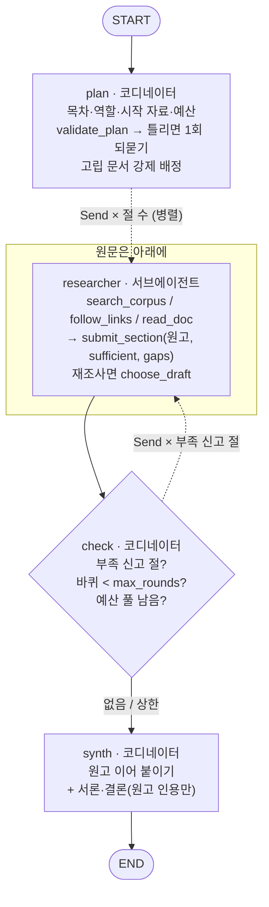
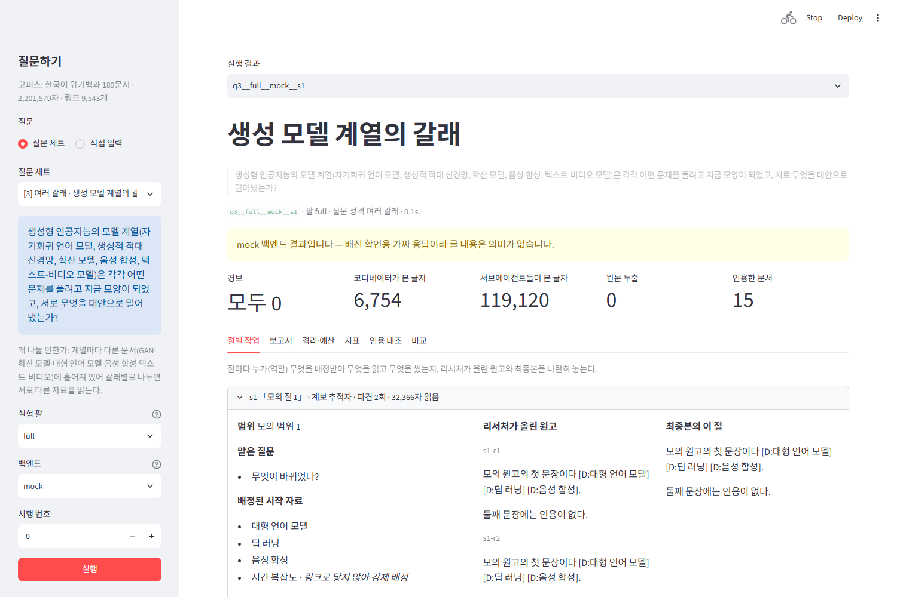
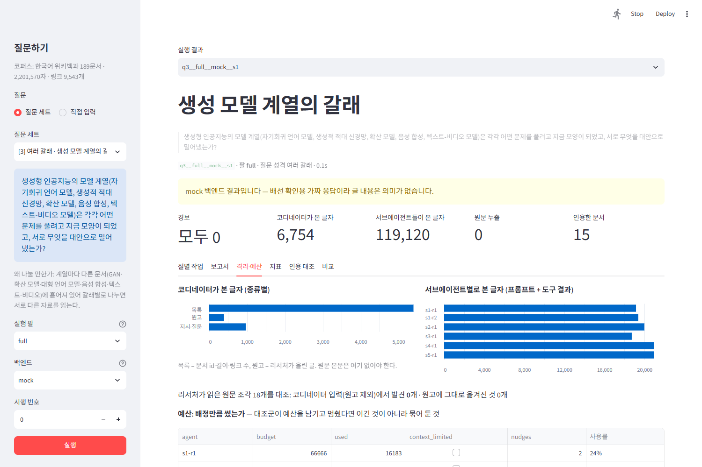
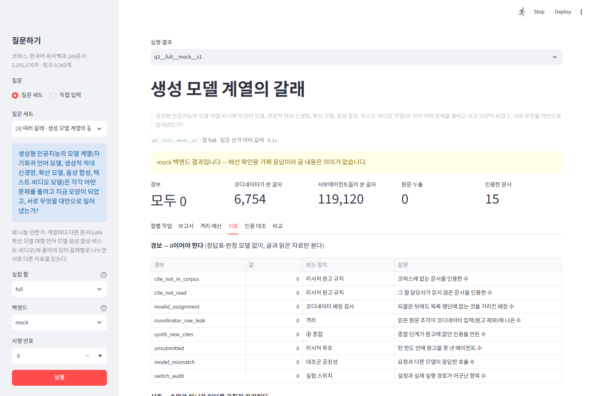
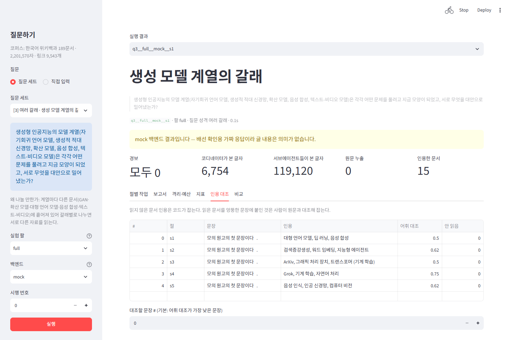

# REPORT — my-deep-researcher

## 1. 주제와 코퍼스

**주제:** 인공지능·기계 학습 기술이 "지금 모양이 된 경위와 대안"을 묻는 장문 리서치.
**코퍼스:** 한국어 위키백과 문서 189건, 총 2,201,570자 (`data/corpus.json`).

### 왜 이 주제와 자료인가
- 기술 개념 문서들은 서로가 서로를 강하게 인용합니다(트랜스포머 ↔ 대형 언어 모델 ↔ RLHF ↔ AI 정렬 …).
  그래서 링크를 따라가는 탐색이 의미 있고, 질문 하나가 여러 문서 묶음으로 자연스럽게 갈라집니다.
- MediaWiki API로 누구나 같은 방식으로 다시 모을 수 있고(`collect_corpus.py`), 본문이 평문이라 인용을 원문과 대조하기 쉽습니다.
- 처음에는 LangChain·LangGraph의 GitHub 이슈·PR을 모았습니다. 하지만 영어 원문과 한국어 보고서 사이의 어휘 대조가 어렵고
  API 제한도 커서, 판정 모델 없이 원문과 대조하는 이번 과제에는 한국어 위키가 더 맞다고 판단했습니다.

### 숫자로 보인 전제 — 컨텍스트 윈도우를 넘는가

| 항목 | 값 |
|---|---|
| 문서 수 | 189 (3,000자 미만 토막글 제외) |
| 총 글자 수 | 2,201,570 |
| 토큰 수 | 추정 1,100,785 ~ 2,201,570 (한국어 글자당 0.5~1 토큰) — 낮게 잡아도 1M을 넘는다. 실측은 `--count` |
| 컨텍스트 윈도우 (`claude-opus-5-5`) | 1,000,000 토큰 |
| 링크(코퍼스 안을 가리키는 것만) | 9,543개, 문서당 중앙값 60 |
| 링크가 0개인 문서 | 3개 — `시간 복잡도`, `낱말`, `자기회귀모형` (아무도 가리키지 않는 문서는 0개) |
| 리서처 1명 기본 예산(12만 자)으로 읽을 수 있는 몫 | 5.5% (189문서 중 대략 10문서 분량) |

- 첫 수집(시드 6개, 2홉, 문서 35건)은 48.9만 자로 컨텍스트에 그대로 들어갔습니다. 넘지 않으면 이 구조를 쓸 이유가 없으므로,
  한국어를 글자당 0.5토큰으로 낮게 잡아도 1M을 넘는 220만 자를 목표로 2홉 범위를 넓혀 다시 모았습니다.
- 정확한 토큰 수는 `python collect_corpus.py --stats --count`(count_tokens API)로 세서 `data/corpus_stats.json`에 남깁니다.
- 링크가 0개인 문서는 링크를 따라가는 탐색으로는 닿지 못하므로, 코디네이터가 기획 단계에서 강제로 배정합니다(2절).

### 질문 세트 (`data/questions.json`, 10건)

정답표는 만들지 않았습니다. 대신 질문마다 "왜 나눌 만한가(또는 왜 아닌가)"를 한 줄로 달았습니다.

| id | 성격 | 질문(요약) | 왜 나눌 만한가 |
|---|---|---|---|
| 0 | 한 건 | RLHF 보상 모델의 학습과 한계 | 나눌 이유 없음 — RLHF 문서 하나에 다 있다 |
| 1 | 한 건 | 선형 회귀의 가정과 대안 추정법 | 나눌 이유 없음 — 선형 회귀 문서 하나 |
| 2 | 한 건 | 셀프 어텐션이 RNN의 어떤 한계를 풀었나 | 거의 없음 — 트랜스포머 문서가 대부분 |
| 3 | 여러 갈래 | 생성 모델 계열(LLM·GAN·확산·음성 합성·텍스트-비디오) | 계열마다 다른 문서 |
| 4 | 여러 갈래 | 학습 방식(지도·비지도·준지도·자기 지도·강화·액티브) | 방식마다 별도 문서와 알고리즘 문서 |
| 5 | 여러 갈래 | AI 붐을 떠받친 인프라(GPU·HBM·병렬·데이터 센터) | 부품마다 문서, 서로 링크 |
| 6 | 여러 갈래 | AI 안전·정렬의 접근들 | 접근마다 다른 문서 |
| 7 | 한 대상 | 대형 언어 모델을 RNN부터 제품까지 따라가기 | 단계마다 다른 문서 |
| 8 | 한 대상 | 딥시크를 회사·챗봇·AI 붐·데이터 센터에서 따라가기 | 서술이 여러 문서에 조각나 있다 |
| 9 | 한 대상 | 음성 기술을 HMM부터 15.ai까지 따라가기 | 시기별로 다른 문서 |

"한 건" 질문 3개는 **이 구조를 쓰면 안 되는 경우**를 보이려고 일부러 넣었습니다. 이런 질문에서는 리서처들이 같은 문서를
나눠 읽어 `read_overlap`이 높게 나오고, 단일 에이전트가 더 적은 비용으로 같은 답을 낼 것으로 예상합니다.

---

## 2. 분업 설계

### 서브에이전트 설계 규칙
1. **목차는 내용 단위로 나눕니다.** 대상·갈래·단계별로 나누고, 개요·연표·분석처럼 형식으로 나누지 않습니다.
   형식으로 나누면 모든 리서처가 같은 자료를 읽기 때문입니다. 반대 조건은 `format_split` 팔이고, `read_overlap`으로 차이를 봅니다.
2. **코디네이터는 원문을 보지 않습니다.** 기획에는 문서 id·길이·링크 수 목록만, 종합에는 리서처 원고만 들어갑니다.
3. **리서처는 자기 절만 씁니다.** 다른 절의 범위를 프롬프트로 받아 접점은 한두 문장으로만 언급합니다(`peer_scopes`).
4. **인용 규칙:** 사실 문장마다 `[D:문서]`를 붙이되, 자기가 `read_doc`으로 읽은 문서에만, 그 내용이 적힌 문서에만 붙입니다.
5. **부족하면 스스로 신고합니다.** `submit_section(sufficient=false, gaps=[…])`.

### 역할 명단 (`config.json`의 `roles`)

| 역할 | 맡는 것 |
|---|---|
| 계보 추적자 | 한 대상이 시기별로 어떻게 바뀌었는지, 무엇을 대체했고 무엇에 밀려났는지 |
| 구조 분석가 | 모델·알고리즘의 구조와 작동 원리, 설계상의 대안 |
| 학습법 분석가 | 학습 방식·훈련 절차·데이터와 레이블 문제 |
| 인프라 분석가 | 하드웨어·연산·메모리·데이터 센터와 그 병목 |
| 응용·산업 조사원 | 제품·기업·서비스와 시장에서의 쓰임과 경쟁 |
| 안전·사회 조사원 | 정렬·안전·규제·사회적 영향과 그 논쟁 |

코디네이터가 절마다 명단에서 역할 하나를 고르고, 그 역할의 관점이 리서처의 시스템 프롬프트에 들어갑니다.
명단은 도메인에 묶인 값이라 `config.json`에 두었습니다. 다른 도메인에서는 명단만 바꾸면 됩니다.

### 배정 · 구역 규칙

| 규칙 | 구현 (`graph.py`) |
|---|---|
| 절마다 역할·범위·질문·시작 자료·예산 | `plan_sections` — JSON 스키마로 받는다. 예산은 `budget_weight`(1~5)로 1차 총예산(절 예산 × 절 수)을 나눈다 |
| **배정이 실제 자료를 가리키는지 코드가 검사** | `validate_plan` — 목록에 없는 문서 id, 시작 자료가 없는 절, 명단에 없는 역할을 짚어 **한 번 되묻고**, 그래도 남으면 버린 뒤 경보 `invalid_assignment`로 센다 |
| 링크로 닿지 않는 문서 | 나가는 링크나 들어오는 링크가 0개인 문서를 BM25로 가장 관련 높은 절의 시작 자료에 강제로 넣는다. 리서처 프롬프트에 "링크로는 닿지 않는 문서"라고 표시한다 (`no_orphan` 팔로 끈다) |
| 동시 파견 | LangGraph `Send`로 절 수만큼 병렬 실행한다(`max_concurrency`) |
| 남의 구역 | 리서처 프롬프트에 다른 절의 제목·역할·범위를 넣는다 |
| 격리를 숫자로 | `Meter`가 코디네이터에게 들어간 글자(목록·지시·원고별)와 서브에이전트마다 들어간 글자(프롬프트+도구 결과)를 따로 센다. 리서처가 읽은 원문 조각이 코디네이터 입력(원고 제외)에 나오는지 대조한다 → 경보 `coordinator_raw_leak` |
| 재파견 | 부족을 **스스로 신고한 절만** 다시 보낸다. 최대 `max_rounds`=2바퀴. 재파견 예산 풀(1차 총예산의 50%)을 남은 바퀴와 절에 나눈다 |
| 같은 규칙, 같은 예산 | 모든 에이전트는 예산의 80% 미만을 읽고 제출하면 최대 2번 되돌려진다. 컨텍스트가 85%에 닿으면 더 읽지 못하게 막고 `context_limited`로 기록한다 |

### 두 번째 원고를 어떻게 하나 (`choose_draft`)

무조건 덮어쓰면 인용을 빠뜨린 새 원고가 멀쩡한 이전 원고를 지웁니다. 그래서 다음 세 조건을 **모두** 만족할 때만 교체합니다.
- 이전 원고의 유효 인용(그 절이 실제로 읽은 문서를 가리키는 인용)을 70% 이상 유지한다.
- 유효 인용 수가 줄지 않았다.
- 무효 인용이 늘지 않았다.

조건을 못 맞추면 이전 원고를 지키고, 새 원고에서 **새로 생긴 유효 인용이 든 줄만** `### 재조사 보충`으로 덧붙입니다.
재조사의 목적은 빈 곳을 채우는 것이므로, 이미 근거를 갖춘 내용을 잃으면서 얻는 것은 손해로 봤습니다.
결정(`replace` / `keep+append` / `keep`)과 이유는 `trace.json`의 `decisions`와 데모의 절별 작업 탭에 남습니다.

---

## 3. 지표 — 무엇이 어느 장치를 보는 신호인가

정답표도 판정 모델도 쓰지 않습니다. 만들어진 글(`report.md`)과 실제로 읽은 자료(`trace.json`)만 봅니다(`metrics.py`).
**신호**는 실행끼리 높낮이를 견주되 순위표로 쓰지 않고 어디를 고칠지 가리키는 데 씁니다.
**경보**는 0이어야 하며, 켜지면 그 실행은 비교에서 빼고 원인부터 고칩니다. 한 줄로 설명이 안 되는 지표는 넣지 않았습니다.

| 종류 | 지표 | 보는 장치 | 한 줄 설명 | 결과가 나쁘면 고칠 곳 |
|---|---|---|---|---|
| 신호 ↑ | `citation_rate` | 리서처 원고 규칙 | 본문 문장 중 인용이 붙은 비율 | 리서처 시스템 프롬프트의 인용 규칙 |
| 신호 ↑ | `lexical_support` | 리서처 인용 습관 | 인용 문장의 핵심어가 인용 문서 원문에 절반 이상 나오는 문장의 비율 | 인용을 붙이는 방식 → 사람이 인용 대조 탭에서 확인 |
| 신호 ↑ | `unique_cited` | 리서처 탐색 폭 | 인용한 서로 다른 문서 수 | 예산, 검색 힌트, 시작 자료 |
| 신호 ↑ | `read_to_cite` | 리서처 원고 작성 | 읽은 문서 중 인용으로 이어진 비율 | 읽기만 하고 안 쓰는지 → 검색·선별 |
| 신호 ↓ | `seed_overlap` | 코디네이터 목차·배정 | 절끼리 시작 자료가 겹치는 정도 | 기획 프롬프트 |
| 신호 ↓ | `read_overlap` | 코디네이터 목차(내용 vs 형식) | 절 담당자들이 읽은 문서 집합의 평균 자카드 | 목차 기준 |
| 신호 ↓ | `text_overlap` | 남의 구역 알려 주기 | 절 본문끼리 겹치는 4-gram 비율 | 남의 구역 블록 |
| 신호 ↑ | `budget_use_min` | 예산 배정·대조군 공정성 | 에이전트별 (읽은 글자 ÷ 배정 예산)의 최솟값 | 예산 배정·되돌림 규칙 |
| 신호 ↑ | `orphan_read_rate` | 고립 문서 배정 | 링크로 닿지 않는 문서 중 누군가 읽은 비율 | 강제 배정 |
| 신호 ↑ | `recheck_new_cites` | ③ 점검·재파견 | 재파견 뒤 최종 원고에 새로 생긴 유효 인용 수 | 재파견 예산·두 번째 원고 처리 |
| 신호 ↓ | `isolation_ratio` | 격리 | 코디네이터가 본 글자 ÷ 서브에이전트들이 본 글자 | 코디네이터 입력 |
| 경보 | `cite_not_in_corpus` | 리서처 원고 규칙 | 코퍼스에 없는 문서를 인용한 수 | 인용 규칙 |
| 경보 | `cite_not_read` | 리서처 원고 규칙 | 그 절 담당자가 읽지 않은 문서를 인용한 수 | 인용 규칙 |
| 경보 | `invalid_assignment` | 코디네이터 배정 검사 | 되물은 뒤에도 목록·명단에 없는 것을 가리킨 배정 수 | 기획 프롬프트 |
| 경보 | `coordinator_raw_leak` | 격리 | 읽은 원문 조각이 코디네이터 입력(원고 제외)에 나온 수 | 코디네이터 입력 경로 |
| 경보 | `synth_new_cites` | ④ 종합 | 종합 단계가 원고에 없던 인용을 만든 수 | 종합 프롬프트 |
| 경보 | `unsubmitted` | 리서처 루프 | 턴 한도 안에 원고를 못 낸 에이전트 수 | 턴 예산 |
| 경보 | `model_mismatch` | 대조군 공정성 | 요청과 다른 모델이 응답한 호출 수 | fallback 설정 |
| 경보 | `switch_audit` | 실험 스위치 | 설정과 실제 실행 경로가 어긋난 항목 수 | 해당 스위치의 코드 경로 |

결과를 의심하기 위한 장치는 세 가지입니다.
- **문장 분리 규칙이 바뀌는 사고:** 분리 함수 소스의 해시(`SPLITTER_VERSION`)를 모든 평가에 기록하고, 버전이 섞인 실행끼리는 `ablation.py`가 비교를 거부합니다.
- **스위치를 껐다고 로그만 찍고 경로는 그대로인 사고:** `switch_audit`은 설정값이 아니라 실행 흔적을 봅니다. 리서처 프롬프트에 남의 구역 블록이 실제로 있는지,
  재파견 수 = 부족 신고 수인지, 바퀴 상한을 지켰는지, 목차가 형식 목차인지, 종합 LLM 호출이 있었는지, 배정된 시작 자료가 프롬프트에 들어갔는지를 확인합니다.
- **한 번 돌린 결과로 단정하는 사고:** `ablation.py`는 같은 설정을 여러 번 돌려 시행별 값을 그대로 남깁니다. 평균만 보지 않습니다.

---

## 4. 파이프라인 구조도

LangGraph 그래프(`graph.py`의 `build_graph`)를 `draw_mermaid()`로 뽑은 것에 상태 흐름을 덧붙였습니다.



**상태(State)**

| 키 | 쓰는 노드 | 병합 방식 | 내용 |
|---|---|---|---|
| `question` | 입력 | — | 질문 dict (`questions.json` 한 줄 또는 직접 입력) |
| `plan`, `plan_info` | plan | 덮어쓰기 | 절 목록(역할·범위·시작 자료·예산), 검사·되묻기 기록 |
| `traces` | researcher | `operator.add` | 에이전트별 검색어·읽은 곳·예산 사용·원고 (데모와 지표의 재료) |
| `drafts` | researcher | dict 병합 | 절 id → 현재 원고 (재조사 때는 `choose_draft`를 거친 결과) |
| `read_sets` | researcher | dict 병합 | 절 id → 그 절이 지금까지 읽은 문서 (인용 유효성 판단 기준) |
| `decisions` | researcher | `operator.add` | 두 번째 원고 처리 결정과 이유 |
| `round`, `pool_left`, `pending` | check | 덮어쓰기 | 끝난 바퀴, 남은 재파견 예산, 다음에 보낼 과제 |
| `events` | 전부 | `operator.add` | 스위치 감사용 실행 흔적 |
| `report`, `synth_info` | synth | 덮어쓰기 | 최종 보고서, 종합이 새로 만든 인용 |

`Send`로 보내는 과제(`Task`)에는 질문, 다른 절 목록(남의 구역), 맡은 절, 예산, 바퀴, 이전 원고가 들어갑니다.
원문은 리서처 노드 안의 `Toolbox`에만 있고 상태로 올라가지 않습니다. 상태에 올라가는 것은 원고와 작업 기록뿐입니다.
LLM·코퍼스·계수기처럼 직렬화할 수 없는 것은 상태가 아니라 `build_graph`의 클로저로 넘깁니다.
단일 에이전트 대조군(`baseline.py`)은 그래프 없이 같은 `agent_loop`·같은 도구로 한 번 실행합니다.

---

## 5. 데모 설계 (`app.py`)

```bash
streamlit run app.py
```

신경 쓴 부분은 다음과 같습니다.
- **첫 탭을 보고서가 아니라 "절별 작업"으로 했습니다.** 숫자만 보여 주는 화면은 이 프로젝트의 요점을 놓칩니다. 절마다 역할, 배정된 시작 자료
  (강제 배정 표시), 예산, 바퀴별 검색어와 읽은 문서(offset·글자 수), 부족 신고, 두 번째 원고 처리 결정을 보여 줍니다.
  오른쪽에는 **리서처가 올린 원고와 최종본의 그 절**을 나란히 놓아, 마음에 안 드는 대목이 어느 절·어느 자료에서 왔는지 바로 따라갈 수 있게 했습니다.
- **격리를 화면에서 숫자로 보여 줍니다.** 코디네이터가 본 글자(목록·지시·원고별)와 서브에이전트별로 본 글자를 막대로 나란히 놓고,
  원문 누출 대조 결과를 함께 보여 줍니다.
- **지표 탭은 경보와 신호를 나눴습니다.** 각 지표 옆에 보는 장치와 한 줄 설명을 붙였고, 순위는 매기지 않습니다.
- **인용 대조 탭:** 인용 문장마다 인용 문서에서 문장 핵심어가 가장 많이 나오는 구간을 강조해 띄웁니다. 기본으로 어휘 대조 점수가 가장 낮은 문장을
  먼저 보여 줍니다. 사람이 "제자리 / 엉뚱한 곳에 붙음 / 일부만"으로 판정해 `citation_notes.json`에 남깁니다.
  읽은 문서를 엉뚱한 문장에 붙인 것은 코드가 못 잡고 사람만 잡기 때문입니다.
- **비교 탭:** 같은 질문의 실행(기본 · 장치 하나 끈 것 · 단일 에이전트)을 나란히 읽고, 판단과 이유를 자기 말로 `output/compare_notes.md`에 적습니다.
- 키가 없으면 백엔드 기본값이 `mock`이고, mock 결과에는 "내용은 의미 없음" 경고를 띄웁니다. API 키는 `.env`로만 받습니다.

| 절별 작업 | 격리·예산 |
|---|---|
|  |  |
| **지표** | **인용 대조** |
|  |  |

> 위 화면은 API 없이 `mock` 백엔드로 만든 실행을 캡처한 것입니다. 화면 구성과 배선을 보여 주는 것이고, 글 내용은 의미가 없습니다.

---

## 6. 결과물 비교

`python ablation.py --question 3 --arms full,no_peer,no_recheck,format_split,single --trials 2`로 같은 질문의 보고서 여러 편을 만들고,
데모의 비교 탭에서 나란히 읽어 `output/compare_notes.md`에 적습니다.

> 이 저장소에 들어 있는 실행 결과는 모두 `mock` 백엔드(배선 확인용)입니다. 실제 모델로 돌린 보고서를 나란히 읽고 판단한 기록은
> 아직 없습니다. API 키를 넣고 위 명령을 실행한 뒤, 이 절에 판단과 이유를 자기 말로 채워야 합니다.

| 읽을 것 | 어디서 |
|---|---|
| 어느 쪽이 나은지와 그 이유 | 비교 탭 → `output/compare_notes.md` |
| 마음에 안 드는 대목의 출처(절·자료) | 절별 작업 탭: 리서처 원고 ↔ 최종본, 읽은 문서 목록 |
| 인용이 제자리에 붙었는지 | 인용 대조 탭 → `citation_notes.json` |
| 대조군이 예산을 다 썼는지 | 격리·예산 탭, `ablation.json`의 `budget_use` · `context_limited` |

---

## 7. 프로젝트 회고

### 가장 공들인 부분
- **"정말 그 장치가 일했나"를 코드가 확인하게 한 것.** 스위치 감사가 설정값 대신 실행 흔적(프롬프트 내용, 이벤트 수, LLM 호출 역할)을 보게 했고,
  고장을 일부러 넣어(남의 구역을 끈 실행의 프롬프트에 구역 정보를 넣기, 재파견을 끈 실행에 재파견 이벤트 넣기 등) 감사가 잡아내는 것을 확인했습니다.
- **격리를 주장이 아니라 숫자로 만든 것.** 코디네이터와 서브에이전트가 본 글자를 따로 세고, 리서처가 읽은 원문 조각이 코디네이터 입력에
  들어갔는지 실제 문자열로 대조합니다.
- **두 번째 원고 처리 규칙.** 재조사 원고가 더 나을 거라는 가정을 버리고, 유효 인용을 기준으로 교체·유지·보충을 가르게 했습니다.
- **대조군 공정성.** 단일 에이전트에 같은 모델·도구·루프·총예산을 주고, "예산 80% 미만이면 되돌린다"는 규칙을 양쪽에 똑같이 걸었습니다.
  예산을 못 쓴 이유가 컨텍스트 한도인지도 따로 기록해, 상대를 묶어 둔 것과 구조적 한계를 구별할 수 있게 했습니다.
- **코퍼스 크기 전제를 정직하게 다룬 것.** 첫 코퍼스가 컨텍스트에 들어간다는 걸 확인하고 범위를 넓혀 다시 모았습니다.
  Wikimedia의 429 제한 때문에 `retry-after` 준수, 간격 하한, 디스크 캐시를 넣었습니다.

### 앞으로 보완하고 싶은 것
- **실제 모델로 비교 실험을 돌리고 직접 읽은 판단을 남기기.** 지금 저장소의 실행 결과는 mock뿐입니다.
- **`lexical_support`의 한계.** 어휘 겹침이라 바꿔 쓴 문장(패러프레이즈)에는 낮게, 핵심어만 같은 엉뚱한 인용에는 높게 나올 수 있습니다.
  그래서 신호로만 쓰고, 최종 판단은 사람이 인용 대조 탭에서 합니다.
- **절 수를 질문에 맞추기.** 지금은 절 수가 고정(5)이라 "한 건" 질문에도 리서처 5명이 나갑니다. 코디네이터가 "나눌 이유가 없다"고 판단하면
  단일 에이전트로 넘기는 경로를 추가하고 싶습니다.
- **한국어 검색 품질.** BM25에 글자 바이그램을 더한 수준이라 동의어나 영문 표기("LLM" vs "대형 언어 모델")를 놓칩니다.
- **되돌림 규칙의 비용.** 예산의 80%를 쓰게 하는 규칙은 대조군 공정성에는 맞지만, 한 건 질문에서는 불필요한 읽기를 늘립니다.
  질문 성격별로 비용과 함께 보고하고 싶습니다.

---

## 출처와 라이선스

`data/corpus.json`의 본문은 [한국어 위키백과](https://ko.wikipedia.org/)에서 MediaWiki API로 받은 것이며
[CC BY-SA 4.0](https://creativecommons.org/licenses/by-sa/4.0/deed.ko)을 따릅니다. 각 문서의 원문 주소는
`https://ko.wikipedia.org/wiki/<문서 제목>`입니다.
